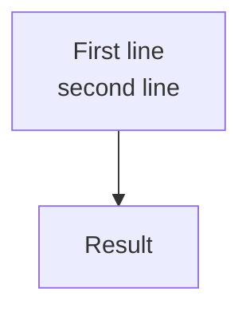

# Markdown Authoring

Format and validate the docs the `self-documenting` skill allows. That skill decides which docs
exist and what they hold; this one decides how they look. Match an established local convention
before applying these defaults.

## Document shape

- New docs get no frontmatter. Dates, status, and versions are state; git holds them.
- If the repository's docs already use frontmatter, match its fields and add no new ones.
- Never invent content; leave an unknown section out and list the question in the report.
- One H1 per file. Skip a table of contents; these files are short enough to scan.

## One-off output

A diagram or report the user asks for that is not one of the project docs goes outside the
project, such as the system temp folder. Give its path. Never add it to the repo.

## Diagrams

Use Mermaid inside the doc, never ASCII art. Choose the diagram type that fits the relationship.
Use ` ` for line breaks in labels; a literal `\n` does not render as a break.

## Formatting

- Wrap prose at 120 characters; exempt code blocks and tables.
- Use a table only to compare items; keep cells compact with single-space padding.
- Avoid inline HTML outside Mermaid content.
- Give every fenced code block a language.

## Validate

From the target repository, run
`${CLAUDE_SKILL_DIR}/scripts/validate-md.sh <file.md>` on every changed Markdown file. It may
rewrite mechanical formatting; re-read a changed file before editing it again. Fix reported
judgment-based violations and repeat until clean.

Read [references/validation.md](references/validation.md) only when validation is skipped, cannot
start, or reports a violation.
